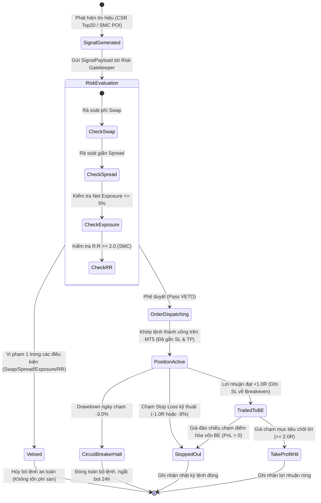

# C4 Model — Level 4: Code & State Machine Architecture (Vòng đời Lệnh & Trạng thái Thực thi)

## 1. Tổng quan Trạng thái Thực thi (Execution & State Machine)
Mức C4 Code mô hình hóa chu trình chuyển đổi trạng thái của một quyết định giao dịch từ khi được sinh ra bởi một trong 2 nhánh chiến lược (CSR hoặc SMC) cho đến khi kết thúc (Take Profit, Stop Loss hoặc bị hủy bởi quyền phủ quyết VETO).

## 2. Sơ đồ Vòng đời Lệnh Tương tác (Interactive Lifecycle Diagram)
Sơ đồ tương tác chuyển động (trace animation) chuẩn HTML/SVG đã được biên dịch thành công qua `archify`:
- 🔗 **File Sơ đồ Tương tác**: [c4-lifecycle.html](file:///Users/hieudz/Desktop/workspace/kltn-multi-agent-trading/C4-Documentation/diagrams/c4-lifecycle.html) *(Mở trực tiếp trên trình duyệt với hiệu ứng trace chuyển động, zoom, pan và export)*.

## 3. Đặc tả Các Trạng thái trong Vòng đời Lệnh

| Trạng thái | Phân loại | Mô tả chi tiết hành vi |
| :--- | :--- | :--- |
| **`Signal Generated`** | Start State | Tín hiệu được sinh ra từ Agent (Đề xuất rổ tái cân bằng CSR hoặc Setup SMC phát hiện vùng FVG/Order Block). Chưa có tác động nào tới tài khoản sàn. |
| **`Risk Evaluation`** | Decision Gate | Risk Gatekeeper độc lập kiểm tra 4 cổng an toàn: Phí Swap, Độ giãn Spread, Net Market Exposure và Tỷ lệ R:R. |
| **`Trade VETOED`** | Terminal Failure | Khi có bất kỳ vi phạm nào, lệnh bị phủ quyết ngay lập tức, ghi log lý do (`VETO_SWAP`, `VETO_SPREAD`, `VETO_EXPOSURE`, `VETO_RR`) và giải phóng vốn. |
| **`Order Dispatching`** | Active Execution | Gửi payload [OrderExecutionIntent](file:///Users/hieudz/Desktop/workspace/kltn-multi-agent-trading/C4-Documentation/contracts/schemas.py) qua giao thức RPyC tới MT5 Terminal. |
| **`Position Active`** | Waiting / Monitoring | Lệnh đã khớp, có gắn sẵn Stop Loss và Take Profit trên máy chủ sàn MT5 để bảo vệ vốn ngay cả khi mất kết nối mạng. |
| **`Trailed to BE`** | Active Protected | Khi giá đi đúng xu hướng đạt $+1.0R$, Agent tự động gửi lệnh chỉnh sửa vị thế dời SL về đúng mức giá vào lệnh (Breakeven - BE). Từ thời điểm này, rủi ro của lệnh bằng $0$. |
| **`Circuit Breaker`** | Emergency Exit | Nếu tổng tài khoản trong ngày bị sụt giảm chạm ngưỡng $-3.0\%$, Circuit Breaker kích hoạt đóng toàn bộ danh mục và ngắt kết nối giao dịch trong 24 giờ. |
| **`Take Profit Hit`** | Terminal Success | Lệnh chạm TP kỳ vọng ($\ge +2.0R$). Đạt mục tiêu lợi nhuận bất đối xứng. |
| **`Stopped Out`** | Terminal Failure | Lệnh chạm SL kỹ thuật (mất đúng $1.0\%$ vốn dự kiến) hoặc chạm BE (hòa vốn). |

## 4. Hợp đồng Dữ liệu Thực thi (Data Models)
Tất cả các trạng thái trên được đảm bảo bởi cấu trúc dữ liệu Pydantic tại [schemas.py](file:///Users/hieudz/Desktop/workspace/kltn-multi-agent-trading/C4-Documentation/contracts/schemas.py):
- `SignalPayload`: Đầu vào từ Signal Agent.
- `RiskVerdict`: Kết quả phán quyết từ Risk Gatekeeper.
- `OrderExecutionIntent`: Chỉ thị gửi xuống MT5 Bridge.
- `CircuitBreakerState`: Trạng thái ngắt mạch an toàn toàn hệ thống.
