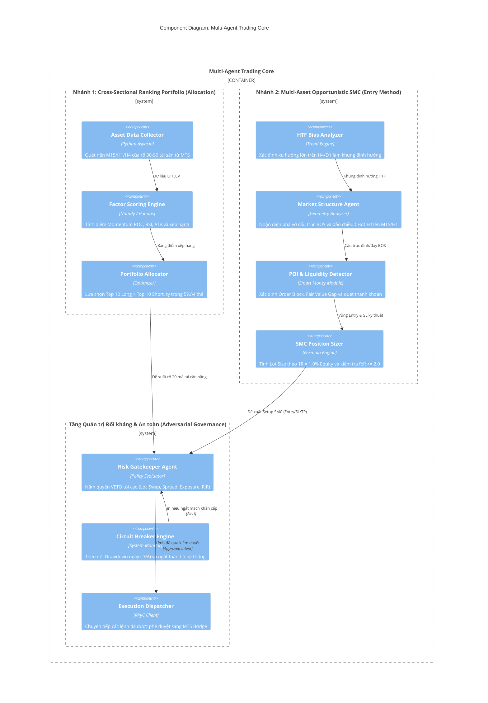

# C4 Model — Level 3: Component Architecture (Kiến trúc Thành phần Multi-Agent)

## 1. Tổng quan Kiến trúc Thành phần (Component Overview)
`multi-agent-core` là trái tim của hệ thống, tổ chức theo mô hình **Đa Tác tử Đối kháng (Adversarial Multi-Agent Governance)**. Trong mô hình này, các Agent tìm kiếm cơ hội kiếm lời (Signal Generators) hoàn toàn độc lập và chịu sự giám sát tối cao của Agent bảo vệ vốn (Risk Gatekeeper) — Agent duy nhất có quyền phủ quyết (**VETO**) trước khi bất kỳ lệnh nào được gửi tới sàn.

## 2. Sơ đồ Thành phần Tương tác (Interactive Component Diagram)
Sơ đồ tương tác chuẩn HTML/SVG đã được biên dịch thành công qua `archify`:
- 🔗 **File Sơ đồ Tương tác**: [c4-component.html](file:///Users/hieudz/Desktop/workspace/kltn-multi-agent-trading/C4-Documentation/diagrams/c4-component.html) *(Mở trực tiếp trên trình duyệt để zoom, pan, đổi dark/light theme và export SVG/PNG)*.

## 3. Chi tiết Các Nhóm Agent

### 3.1. Nhóm Agent Nhánh 1: Cross-Sectional Ranking Portfolio
- **Asset Data Collector**: Định kỳ $4H$ hoặc $Daily$ tải dữ liệu nến đồng bộ của toàn bộ vũ trụ $30 - 50$ mã Forex/Crypto/Indices.
- **Factor Scoring Engine**: Áp dụng công thức chuẩn hóa điểm Z-Score:
  $$\text{Score} = w_{\text{ROC}} \cdot Z(\text{ROC}) + w_{\text{RSI}} \cdot Z(\text{RSI}) + w_{\text{Trend}} \cdot Z(\text{EMA}) - w_{\text{ATR}} \cdot Z(\text{ATR})$$
- **Portfolio Allocator**: Lựa chọn 10 mã có Score cao nhất để MUA và 10 mã có Score thấp nhất để BÁN. Mỗi mã phân bổ chính xác $5\%$ tài khoản để đảm bảo trung lập thị trường ($|\sum w_{\text{Long}} - \sum w_{\text{Short}}| \le 5\%$).

### 3.2. Nhóm Agent Nhánh 2: Multi-Asset Opportunistic SMC Trading
- **HTF Bias Analyzer**: Xác định cấu trúc đỉnh cao dần / đáy cao dần (Bullish) hoặc đỉnh thấp dần / đáy thấp dần (Bearish) trên nến H4/D1.
- **Market Structure Agent**: Tìm các điểm BOS (tiếp diễn xu hướng) và CHoCH (bắt đầu đảo chiều) trên khung thời gian vào lệnh M15.
- **POI & Liquidity Detector**: Xác định Order Block (cây nến đối màu cuối cùng trước đợt bùng nổ thanh khoản), FVG (vùng nến 3 thanh không chồng lấn) và phát hiện cú quét thanh khoản (Liquidity Sweep).
- **SMC Position Sizer**: Tính toán khối lượng giao dịch chính xác:
  $$\text{Lot Size} = \frac{\text{Equity} \times 1\%}{\text{Khoảng cách Entry đến SL} \times \text{Pip Value}}$$
  Bắt buộc $TP \ge 2 \times SL$ ($R:R \ge 1:2.0$).

### 3.3. Tầng Quản trị Đối kháng (Adversarial Governance)
- **Risk Gatekeeper Agent**:
  - Không sinh tín hiệu mà chỉ nhận đề xuất từ 2 nhánh.
  - Áp dụng các quy tắc kiểm tra nghiêm ngặt:
    1. **Swap Check**: Phí qua đêm của lệnh giữ dài có ăn mòn lợi nhuận không? (Nếu Swap âm nặng ➔ **VETO**).
    2. **Spread Check**: Spread hiện tại có lớn hơn $1.5 \times \text{Spread trung bình}$ không? (Nếu giãn spread ➔ **VETO**).
    3. **Net Exposure Check**: Tổng vị thế Long/Short có vượt quá $5\%$ chênh lệch không? (Nếu lệch ➔ **VETO / Điều chỉnh**).
    4. **R:R Check**: Lệnh SMC có đạt tối thiểu $1:2.0$ không? (Nếu thấp hơn ➔ **VETO**).
- **Circuit Breaker Engine**:
  - Giám sát Equity theo thời gian thực.
  - Nếu Drawdown trong ngày chạm $-3.0\%$ ➔ Kích hoạt ngắt mạch khẩn cấp: đóng toàn bộ vị thế đang mở và khóa hệ thống 24 giờ.
