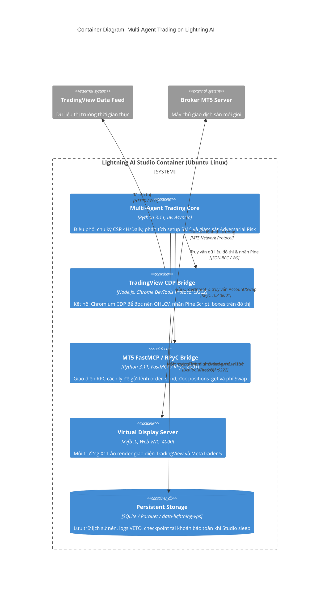

# C4 Model — Level 2: Container Architecture (Kiến trúc Container / Runtime)

## 1. Tổng quan Kiến trúc Hạ tầng (Infrastructure Architecture)
Hệ thống toàn bộ được đóng gói và vận hành trong một môi trường máy chủ đám mây thống nhất: **Lightning AI Studio (Ubuntu Linux)**. Để khắc phục bài toán MT5 và TradingView Desktop chỉ có giao diện đồ họa (GUI), hệ thống sử dụng server hiển thị ảo `Xvfb :0` kết hợp giao thức điều khiển không đầu (headless) và FastMCP RPC bridge.

## 2. Sơ đồ Container Tương tác (Interactive Container Diagram)
Sơ đồ tương tác chuẩn HTML/SVG đã được biên dịch thành công qua `archify`:
- 🔗 **File Sơ đồ Tương tác**: [c4-container.html](file:///Users/hieudz/Desktop/workspace/kltn-multi-agent-trading/C4-Documentation/diagrams/c4-container.html) *(Mở trực tiếp trên trình duyệt để zoom, pan, đổi dark/light theme và export SVG/PNG)*.

## 3. Đặc tả Danh mục Container (Container Inventory)

| Container / Service | Công nghệ | Cổng / Giao thức | Chức năng chính |
| :--- | :--- | :--- | :--- |
| **`multi-agent-core`** | Python 3.11 (`uv`) | Internal In-Process | Chạy vòng lặp phân tích cho cả 2 chiến lược (CSR & SMC), chứa Adversarial Risk Gatekeeper. |
| **`tradingview-cdp-bridge`** | Node.js (Puppeteer-core / ws) | `http://127.0.0.1:9222` (CDP) | Hook vào Chrome DevTools Protocol của TradingView Desktop để cào các bảng tính, nhãn vùng giá (Order Blocks, FVG) do script Pine vẽ ra. |
| **`mt5-mcp-bridge`** | Python FastMCP & RPyC | `tcp://127.0.0.1:8001` (RPyC) | Cung cấp các công cụ gọi hàm chuẩn hóa: `mt5_get_symbols()`, `mt5_get_swap()`, `mt5_order_send()`, `mt5_positions_get()`. |
| **`virtual-display`** | Xvfb + NoMachine / VNC | Display `:0`, Port `4000` | Tạo màn hình ảo để chạy TradingView và MT5 Desktop trên Linux server không màn hình. |
| **`persistent-storage`** | SQLite + Parquet | Filesystem (`/workspace/data-lightning-vps`) | Khắc phục đặc thù của Lightning AI: mount dữ liệu ra thư mục ngoài để giữ nguyên token đăng nhập MT5/TradingView và lịch sử giao dịch. |

## 4. Đặc tả Giao diện Gọi Hàm (Tool / RPC Contract)
Chi tiết các Pydantic schema dùng để giao tiếp giữa `multi-agent-core` và các bridge được lưu tại:
👉 [schemas.py](file:///Users/hieudz/Desktop/workspace/kltn-multi-agent-trading/C4-Documentation/contracts/schemas.py)

### Danh mục MCP Tools của MT5 Bridge:
- `get_account_summary()`: Trả về [MT5AccountSnapshot](file:///Users/hieudz/Desktop/workspace/kltn-multi-agent-trading/C4-Documentation/contracts/schemas.py).
- `get_swap_and_spread(symbol: str, direction: str)`: Kiểm tra phí qua đêm và độ giãn spread trước khi mở lệnh.
- `execute_order(intent: OrderExecutionIntent)`: Phát lệnh thực thi vào MT5 có bảo vệ SL/TP.
- `close_position(position_id: int)`: Đóng vị thế khẩn cấp khi vi phạm Stop Loss hoặc Circuit Breaker.
- `modify_position(position_id: int, sl: float, tp: float)`: Dời Stop Loss về hòa vốn (+1.0R) hoặc trailing stop.
