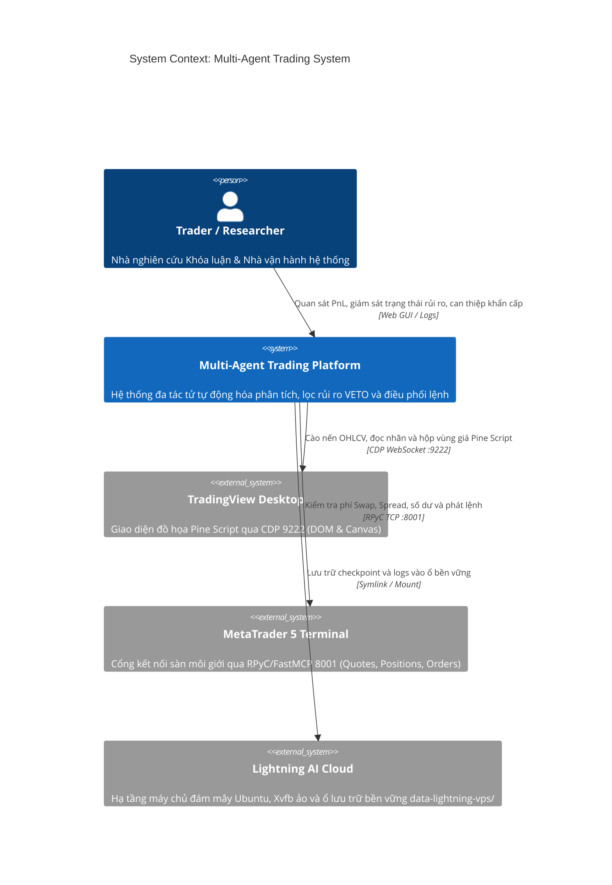

# C4 Model — Level 1: System Context (Ngữ cảnh Hệ thống)

## 1. Tổng quan Hệ thống (System Overview)
Hệ thống **Multi-Agent Quantitative Trading Platform** là nền tảng giao dịch tự động hóa cao cấp được xây dựng phục vụ Khóa luận Tốt nghiệp (KLTN). Hệ thống vận hành độc lập trên môi trường đám mây **Lightning AI Studio**, tích hợp 02 hướng tiếp cận:
1. **Rổ Danh mục Định lượng Trung lập Thị trường (Cross-Sectional Ranking Portfolio)**: Quản lý danh mục định lượng, tự động xếp hạng đa nhân tố và tái cân bằng định kỳ.
2. **Giao dịch Cơ hội Đa Tài sản theo Cấu trúc SMC (Multi-Asset Opportunistic SMC Trading)**: Giao dịch theo sự kiện (Event-driven), khai thác điểm vào lệnh bất đối xứng ($R:R \ge 1:2.0$) dựa trên cấu trúc Smart Money Concepts.

## 2. Sơ đồ Ngữ cảnh Tương tác (Interactive System Context Diagram)
Sơ đồ tương tác chuẩn HTML/SVG đã được biên dịch thành công thông qua `archify`:
- 🔗 **File Sơ đồ Tương tác**: [c4-context.html](file:///Users/hieudz/Desktop/workspace/kltn-multi-agent-trading/C4-Documentation/diagrams/c4-context.html) *(Mở trực tiếp trên trình duyệt để zoom, pan, đổi dark/light theme và export SVG/PNG)*.

## 3. Các Tác nhân & Hệ thống Bên ngoài (Actors & External Systems)

| Thực thể | Phân loại | Mô tả vai trò & Giao thức tương tác |
| :--- | :--- | :--- |
| **Trader / Researcher** | Human Actor | Người vận hành, theo dõi báo cáo backtest, đánh giá hiệu quả Alpha Spread và can thiệp tham số rủi ro. |
| **Multi-Agent Core** | Core System | Hệ thống trung tâm điều phối 2 nhánh chiến lược, đóng vai trò tạo quyết định và kiểm soát rủi ro độc lập. |
| **TradingView Desktop** | External System | Chạy trên display ảo Xvfb; cung cấp chỉ báo kỹ thuật tùy biến (Pine Script) qua Chrome DevTools Protocol (CDP port 9222). |
| **MetaTrader 5 Terminal** | External System | Chạy trên Wine/Linux hoặc Docker; chịu trách nhiệm tiếp nhận lệnh thực thi qua FastMCP / RPyC (port 8001). |
| **Lightning AI Studio** | Cloud Infrastructure | Môi trường lưu trữ và tính toán đám mây liên tục 24/7; hỗ trợ symlink thư mục `data-lightning-vps/` để bảo toàn trạng thái sau sleep/wake. |

## 4. Kịch bản Vận hành Cốt lõi (User & Agent Journeys)

### Kịch bản 1: Chu kỳ Tái cân bằng Rổ CSR (Fixed Schedule — 4H/Daily)
1. **Trigger**: Bộ định thời kích hoạt chu kỳ tái cân bằng.
2. **Fetch Data**: Agent thu thập dữ liệu $30 - 50$ mã từ MT5.
3. **Scoring**: Tính điểm đa nhân tố (Momentum ROC, RSI, ATR, EMA Trend).
4. **Draft Allocation**: Đề xuất mở 10 Long mạnh nhất và 10 Short yếu nhất (mỗi mã 5% vốn).
5. **Adversarial Gatekeeper**: Kiểm tra phí Swap từng mã, spread hiện tại và Net Exposure danh mục. Nếu vi phạm ➔ **Kích hoạt VETO**.
6. **Execution**: Gửi danh sách vị thế hợp lệ qua MT5 để khớp lệnh đồng thời.

### Kịch bản 2: Bắn Tín hiệu Cơ hội SMC (Event-Driven — Real-time)
1. **Trigger**: Nến M15/H1 đóng cửa hoặc TradingView phát nhãn tín hiệu.
2. **Structure Analysis**: Nhận diện xu hướng HTF Bias (H4/D1) kết hợp BOS/CHoCH trên M15.
3. **POI Identification**: Xác định vùng Order Block, FVG và thanh khoản Inducement.
4. **Position Sizing**: Đo khoảng cách SL từ Entry, tự động tính Lot Size theo công thức $1R = 1.0\%$ Equity.
5. **Risk Gatekeeper**: Kiểm tra tỷ lệ $R:R \ge 1:2.0$. Nếu thỏa mãn ➔ Phê duyệt.
6. **Execution & Trailing**: Gửi lệnh có gắn SL/TP; khi giá đạt $+1.0R$, tự động dời SL về Breakeven (BE).
