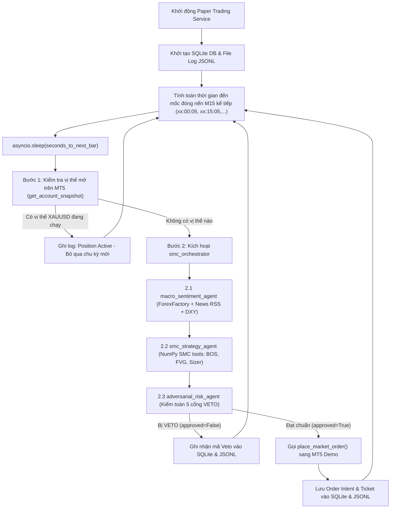

# Đặc tả Thiết kế Kỹ thuật: SMC Paper Trading Runtime Service

## 1. Mục đích & Phạm vi
- **Mục đích**: Vận hành tự động hệ thống giao dịch SMC Multi-Agent trên tài khoản MT5 Demo theo thời gian thực, đảm bảo tính liên tục, không lỗi tràn bộ nhớ và lưu vết dữ liệu phục vụ nghiên cứu KLTN.
- **Phạm vi**: Cặp tiền tệ / hàng hóa `XAUUSD` trên khung thời gian M15.

---

## 2. Kiến trúc Luồng Thực thi (Runtime Execution Pipeline)

---

## 3. Cấu trúc Thành phần Triển khai

### 3.1. Runner Service: `src/runners/paper_trading_runner.py`
- **Hàm `calculate_sleep_seconds()`**:
  - Tính thời gian còn lại đến nến M15 tiếp theo: `900 - (current_timestamp % 900) + 5` (buffer 5 giây để MT5 kịp chốt nến M15).
- **Hàm `execute_cycle()`**:
  - Kết nối MT5 lấy snapshot tài khoản. Nếu `positions_count > 0` cho `XAUUSD`, thoát sớm.
  - Chuẩn bị context và gọi `runner.run()` thông qua `InMemoryRunner(agent=smc_orchestrator)`.
  - Phân tích output trả về từ các Event (`macro_sentiment`, `smc_setup`, `risk_verdict`).
- **Hàm `main_loop()`**:
  - Vòng lặp `while running:` bất đồng bộ.
  - Xử lý tín hiệu tắt an toàn: bắt `signal.SIGINT` và `signal.SIGTERM` để đóng kết nối MT5 sạch sẽ trước khi thoát.

### 3.2. Cấu trúc Cơ sở Dữ liệu Lưu vết (SQLite Schema): `data/paper_trading.db`
Bảng `paper_cycles`:
- `id` (INTEGER PRIMARY KEY AUTOINCREMENT)
- `cycle_time` (TIMESTAMP UTC)
- `symbol` (TEXT, e.g. "XAUUSD")
- `macro_regime` (TEXT, e.g. "RISK_ON", "HIGH_IMPACT_NEWS_COOLDOWN")
- `dxy_bias` (TEXT, e.g. "BULLISH", "BEARISH")
- `setup_direction` (TEXT, e.g. "BUY", "SELL", NULL)
- `entry_price` (REAL)
- `stop_loss` (REAL)
- `take_profit` (REAL)
- `lot_size` (REAL)
- `risk_reward_ratio` (REAL)
- `is_valid_setup` (BOOLEAN)
- `risk_approved` (BOOLEAN)
- `veto_code` (TEXT, e.g. "VETO_CIRCUIT", "VETO_SPREAD", NULL)
- `veto_reason` (TEXT)
- `order_ticket` (INTEGER, NULL nếu bị Veto)

---

## 4. Decision Log (Nhật ký Quyết định)

| Quyết định | Lựa chọn đã chốt | Các phương án bị loại | Lý do lựa chọn |
| :--- | :--- | :--- | :--- |
| **Môi trường khớp lệnh** | MT5 Demo Broker Account (Lựa chọn A) | Tự giả lập nội bộ (Lựa chọn B) | Phản ánh chính xác điều kiện thị trường thật (spread động, trượt giá, cơ chế margin của sàn thật). |
| **Cơ chế kích hoạt** | Căn nến M15 Bar-Close (Lựa chọn 1) | Tick Streaming (Lựa chọn 2), Manual Trigger (Lựa chọn 3) | SMC là chiến lược swing/day-trading theo nến đóng, không cần quét từng tick gây lãng phí tài nguyên LLM. |
| **Lưu vết & Quan sát** | SQLite DB + Structured JSONL (Lựa chọn 1) | Console Log đơn giản (Lựa chọn 2), Telegram Bot (Lựa chọn 3) | Lưu trữ có cấu trúc hỗ trợ trích xuất số liệu, biểu đồ PnL và bảng thống kê cho bài báo cáo KLTN. |
| **Quản lý vị thế mở** | Strict 1 Active Trade (Lựa chọn A) | Trailing Stop (Lựa chọn B), Nhồi lệnh (Lựa chọn C) | Tuân thủ kỷ luật quản lý vốn 1R, tránh rủi ro tài khoản khi thị trường đi ngược xu hướng. |
| **Kiến trúc Vòng lặp** | Asyncio Event Loop (Phương án 1) | APScheduler (Phương án 2) | Gọn nhẹ, không thêm thư viện ngoài, tương thích tuyệt đối với Google ADK `InMemoryRunner`. |
